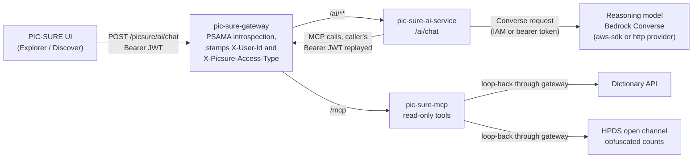
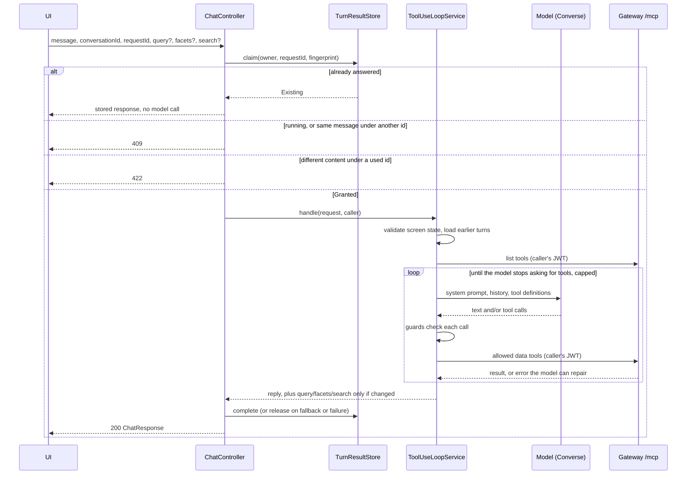
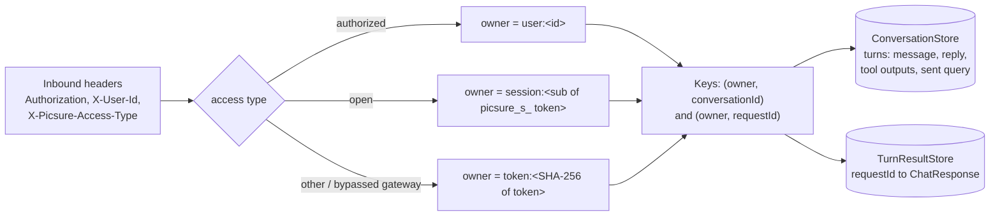
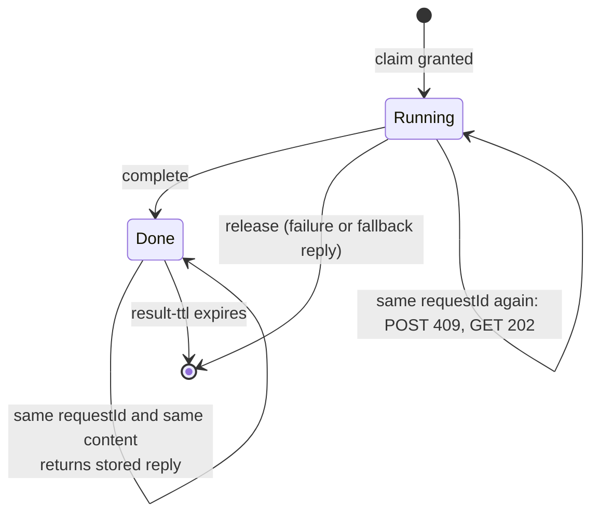

# pic-sure-ai-service architecture

How the service is put together today. For configuration, model choice, logging and the full guard table, see the
[README](../README.md).

## 1. Where it sits

The service is one hop behind the gateway. It talks to two things: the reasoning model (Bedrock Converse) and the gateway's `/mcp`
route, which fronts `pic-sure-mcp`. The model and the MCP tools never talk to each other; this service is the only hub.



Two credentials, never mixed:

| Hop | Credential |
| --- | --- |
| UI to gateway to this service, and this service back through the gateway to MCP | The caller's own bearer JWT, passed through untouched. This service never mints, caches or exchanges one. |
| This service to the model | The deployment's AWS identity (default credential chain), or a static bearer token for the `http` provider. Unrelated to PIC-SURE identity. |

The service does no authentication itself. It trusts the identity headers the gateway sets, which is why it must only be
reachable through the gateway.

## 2. One chat turn

`POST /ai/chat` is plain request/response: one request, possibly several model and tool round-trips, one response.



Things the diagram does not show:

- `propose_query` is handled inside this service and never reaches the gateway. It is the model handing back structured state for
  the researcher to review, not a data-access call.
- Every model call resends the whole in-turn history, so input tokens are summed over the turn (see the `Chat turn:` log line).
- The loop is bounded: `AI_MAX_TOOL_ITERATIONS` round-trips, plus one final call that answers from what it has.

## 3. Inside the loop

The model's tool calls and replies are treated as untrusted. Each tool call passes through the checks below before it runs, and
the reply is checked again before it goes out. The full catalogue, one row per misbehavior, is in the README's
[Guarding against model behavior](../README.md#guarding-against-model-behavior).

```mermaid
flowchart TD
    A([Model returns]) --> B{Tool calls?}
    B -- yes --> C{Excluded tool?<br/>or count tool for<br/>an authorized caller}
    C -- yes --> X[/"Unknown tool" error/]
    C -- no --> D{Args valid JSON,<br/>every concept path<br/>seen in a result?}
    D -- no --> X2[/Refuse, model can repair/]
    D -- yes --> E{Which tool?}
    E -- propose_query --> P["ProposeQueryTool + ProposalRules<br/>validate, repair, hold the proposal<br/>(local, no gateway call)"]
    E -- search_concepts --> S["Check facets are known,<br/>TermBalancedSearch,<br/>then gateway"]
    E -- other data tool --> G[Gateway call]
    P --> R[Append result to history]
    S --> R
    G --> R
    X --> R
    X2 --> R
    R --> F{Iteration cap, or same error 3 times?}
    F -- yes --> Z["Answer-now result,<br/>one last model call"]
    F -- no --> A
    Z --> T
    B -- no --> H{"Empty reply, unknown paths,<br/>or false 'selection changed' claim?"}
    H -- yes, within retry limits --> W[Ask the model to rewrite] --> A
    H -- no --> T["Reply fixes: proposal written as text,<br/>counted-but-unproposed query,<br/>scrub query JSON, restore paths"]
    T --> U["respond: attach query/facets/search<br/>only where they differ from the screen"]
    U --> V[(Store turn in conversation)]
    V --> O([ChatResponse])
```



### Tool set the model sees

| Tool | Source | Notes |
| --- | --- | --- |
| `search_concepts`, `list_facets`, `get_concept`, `get_concepts` | `pic-sure-mcp` via gateway | Always offered. |
| `count_participants`, `cross_count` | `pic-sure-mcp` via gateway | Obfuscated open-access counts. Withheld from authorized (logged-in) callers, whose results panel shows exact counts; the system prompt tells the model it cannot count. |
| `get_adapter_code` | `pic-sure-mcp` via gateway | Withheld by default (`AI_MCP_EXCLUDED_TOOLS`) to save input tokens. |
| `propose_query` | This service | Query, facets and search proposals. Selected variables are a change (`addSelect` / `removeSelect`), not a list. |

The system prompt has two variants (open and authorized caller) built from one template, so it stays identical between turns and
cacheable. The researcher's current query, facets and search are appended to the user message as labeled data, not put in the
prompt.

## 4. Identity, ownership and stored state

Conversation history and finished turn results are keyed by an owner derived from the caller, never by a server session.



- Both stores are Caffeine-backed, in memory, behind interfaces. State is lost on restart and not shared between instances, so run
  one instance or use sticky sessions. A shared store would be a new implementation selected by `picsure.ai.conversation.store`.
- `X-User-Id` alone is never the owner for open access, because every open-access caller shares it. PSAMA reissues the open-session
  token every few minutes with the same `sub`, so the session id stays stable across token refreshes.
- Only the final reply of each turn is stored for the model to read later. Tool outputs are stored too, but only to rebuild what the
  guards have seen (known concept paths and facets, unmatched terms), so an earlier lookup does not force a re-search. They are not
  replayed to the model.
- The researcher's screen state (`query`, `facets`, `search`) is client-resent on every request and always wins over anything
  described earlier. The service keeps the query it last sent, only to tell the model what the researcher removed by hand since.
- A failed turn, or one that ends in the fallback text, is not stored, so its retry starts from the same place.

### Idempotency states for `requestId`



A reused `requestId` with different content is refused with 422. The same message sent under a new `requestId` while the first is
still running gets 409 with the first id, so the client can `GET /ai/chat/{requestId}` for it.

## 5. Package layout

```
edu.harvard.hms.dbmi.avillach.ai
  chat/    ChatController, ToolUseLoopService (the loop), ProposeQueryTool + ProposalRules + ProposeQueryInput,
           ConceptPaths / KnownFacets / SearchHistory (provenance), ReplyText (reply checks), TermBalancedSearch,
           ConversationStore + TurnResultStore (interfaces, in-memory impls), CallerContext, CurrentState, EarlierTurns
  model/   ConverseModelClient (interface), ConverseSdkModelClient (aws-sdk), ConverseHttpModelClient (http),
           the only package that may touch Bedrock or Spring AI types
  mcp/     McpToolGateway (interface), gateway/GatewayMcpToolGateway (MCP client against the gateway's /mcp)
  config/  security (stateless, permit-all, actuator gate), CallerContext argument resolver, request config
  error/   validation error advice, one-line error summaries for logs
resources/prompts/system-prompt.txt   one sentence per line, with {{capabilities}} and {{counts}} placeholders
```

Boundaries enforced or relied on:

- `ArchitectureTest` fails the build if anything outside `ai.model` depends on `org.springframework.ai..` or
  `software.amazon.awssdk..`, so swapping the model provider stays a one-package change.
- Spring AI's own tool execution is turned off (`internal-tool-execution-enabled: false`). The iteration cap, dispatch and error
  shaping are hand-written in `ToolUseLoopService`.
- A tool or MCP failure becomes a model-visible error result and never fails the turn. A model outage (`model_unavailable`) or an
  unreachable tool list (`tools_unavailable`) fails the turn with 503.

## 6. Error contract

| Status | `errorType` | When |
| --- | --- | --- |
| 400 | `invalid_request` (state fields) or bean validation (required fields) | A required field is missing or blank, or `query`/`facets`/`search` is malformed |
| 401 | `unauthorized` | `Authorization` header missing or not a bearer token |
| 404 | `turn_not_found` | `GET /chat/{requestId}`: nothing stored, failed, or expired. Also every route when `AI_ENABLED=false` |
| 409 | `turn_in_progress`, `duplicate_in_progress` | The message is still being answered |
| 422 | `request_id_reused` | Same `requestId`, different message or state |
| 500 | `internal_error` | Unexpected failure |
| 503 | `model_unavailable`, `tools_unavailable` | Bedrock call failed, or the gateway's tool list could not be fetched |
