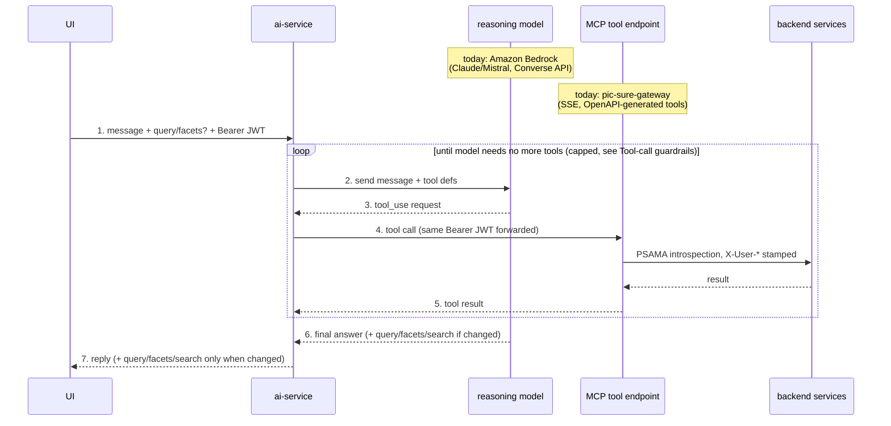

# AI-Assisted Search / Bedrock Integration Plan

Status: early design — architecture agreed, UI not yet planned (see open items).

Companion to `TRACKER.md` (the categorized work list, with ACs — account,
Bedrock credentials, VPC/guardrails/logging, bake-off, cost controls — none
of which this doc covers).

## Goal

Let a user ask a natural-language question (optionally alongside their current
PIC-SURE query) and get back a chat response plus an updated query object,
with the model able to pull real PIC-SURE data on the user's behalf via tools
along the way.

Three things this needs to do:
- [ ] Accept a user message + current query + the user's auth on a PIC-SURE
      API endpoint, and send it to Bedrock.
- [ ] Let Bedrock call back into PIC-SURE (via MCP) to fetch data the model
      needs, on behalf of the user.
- [ ] Return a response to the user, and an updated query object *only when
      the query actually changed* (see **Use-case alignment**, below — most
      turns are dictionary Q&A with no query involved at all).

## API Architecture

### Request lifecycle

How a single chat turn moves through the pieces below — the one-page version
of **Transport**, **Auth**, and **Tool-call guardrails**, further down.
Participant names are deliberately generic (`reasoning model`, `MCP tool
endpoint`) since those roles have to exist regardless of vendor; the `Note`s
call out which concrete product fills each role today, so swapping one later
is a label change here, not a redesign.

Not obvious from the diagram alone:
- `ai-service` is the only hub — it's the one piece that talks to both the
  model and the MCP endpoint; they never talk to each other directly.
- The Bearer JWT crossing steps 1 and 4 is the *same* token, not an
  exchanged/minted one — see **Auth**, below. Bedrock's own credentials (API
  key today, IAM later) are a separate hop and never touch PIC-SURE identity.
- The loop (steps 2–5) is bounded by the max-iteration guardrail in
  **Tool-call guardrails**, not left open-ended.

### Tool dispatch: MCP vs. locally-handled tools

The loop above is driven by two signals on each model response, not one:

- **`stopReason`/`stop_reason`** (`tool_use` vs. `end_turn`) — whether the
  model wants something before it can answer, or is done. `end_turn` is what
  lets `ai-service` drop out of the loop and move to step 7; it also means
  the response is final as of *this* model turn, not something to
  re-validate afterward (see below).
- **The tool's name**, inside each `toolUse`/`tool_use` content block — this
  is what `ai-service` routes on, and not every tool call reaches MCP:
  - Data-fetching tools (dictionary search, facet lookup, etc.) → forwarded
    to the MCP endpoint, as drawn (step 4).
  - The query/facets/search proposal tool (the "schema-constrained
    tool-call" mentioned in **Transport**) → handled by `ai-service` itself,
    never forwarded to MCP — it's not a data-access call, it's the model
    handing back structured state for the researcher to review. It validates
    the proposed object's shape, then re-verifies only the *newly added*
    concept paths/facets (diffed against the current `query`/`facets` resent
    on the request) via `get_concept`/`list_facets` through the normal MCP
    gateway call, and feeds the result (success, or an error naming what's
    wrong) back as that tool's result — the same repair-loop mechanism as any
    other tool call, not a separate code path. No HPDS round-trip is needed:
    a concept path that `get_concept` returns is, by construction, both real
    and something this caller can see (the dictionary is already
    authorization-filtered), which is the validity bar that matters here.
    (Decided 6 Oct 2026 — see `TRACKER.md`'s `validation-repair`.)

Net effect: by the time the model reaches `end_turn`, any query/facets/
search object already attached to the conversation has already been
validated during the loop. `ai-service` doesn't do a separate
validate-then-return step after the loop — it returns whatever was last
successfully validated inside it.

### Model-provider portability: Bedrock vs. a direct Claude API

Checked whether swapping the Bedrock Converse API for calling Claude
directly via Anthropic's Messages API (e.g. for a local PIC-SURE instance
without AWS access) would change anything above. It wouldn't, beyond the one
client module — Bedrock's Converse tool-use shape was modeled closely on
Anthropic's native one:

| | Bedrock Converse API | Anthropic Messages API |
|---|---|---|
| done vs. wants a tool | `stopReason`: `end_turn` / `tool_use` | `stop_reason`: `end_turn` / `tool_use` |
| the tool request | `toolUse` block (`toolUseId`, `name`, `input`) | `tool_use` block (`id`, `name`, `input`) |
| sending the result back | `toolResult`, keyed by `toolUseId` | `tool_result`, keyed by `tool_use_id`, optional `is_error` |
| tool defs on the request | `toolConfig.tools` | top-level `tools` |
| auth | Bedrock API key or IAM | `x-api-key` (Anthropic API key) |

So the dispatch logic above (stop signal + tool-name routing) is unchanged;
only the one client module swaps its SDK call, endpoint, and auth header —
the "today: ___" `Note`s in the **Request lifecycle** diagram change,
nothing else does.

One consequence worth keeping: for a local/dev setup, `ai-service` driving
the loop itself (rather than delegating it — see the AgentCore item in
**Open items**) means the local MCP endpoint never needs to be reachable
from the internet. Neither Anthropic's nor AWS's infrastructure calls back
into it; `ai-service` is always the one making the outbound call, whether
that's to `localhost` or a deployed gateway. That's a second, independent
reason (beyond the portability one already in **Open items**) to keep this
app-side for now.

### New service: `pic-sure-ai-service`

A new service under `services/`, mirroring the layout/conventions of
`pic-sure-operations-service`. Owns:
- The UI-facing chat endpoint (see **Transport**, below).
- The Bedrock Converse API client and tool-use loop.
- Acting as an MCP *client* against the gateway's MCP endpoint (see below) —
  it does not implement MCP tools itself.

### MCP endpoint: served from the gateway

A coworker is adding an OpenAPI-powered MCP endpoint to `pic-sure-gateway`,
auto-generating MCP tools from the existing (or soon-to-be-standardized —
see `origin/openapi/dependencies`, which adds the shared `pic-sure-openapi`
springdoc autoconfiguration) OpenAPI specs of the backend services.

- Served from the gateway itself, so it inherits the gateway's existing auth
  automatically — no separate identity/session-token scheme needed (see
  **Auth**, below).
- Transport: SSE.
- Route: `/mcp` on the gateway (see **Open items**).
- Tool surface / what exactly gets exposed and how it's narrowed down:
  **TBD**, out of scope for this document — treat it as a given interface
  (a gateway-hosted, SSE MCP endpoint that PIC-SURE data operations can be
  called through) rather than something this plan designs.

### Auth

Confirmed by reading `PsamaIntrospectionFilter` /
`IdentityPropagationFilter` in `pic-sure-gateway`: the gateway does PSAMA
introspection and stamps `X-User-*` identity headers on the forwarded
request, but it does **not** strip or mutate the original `Authorization`
header — the user's bearer JWT passes through untouched.

Consequence: `pic-sure-ai-service` does not need to mint or manage any
session/exchange token. It just retains the `Authorization: Bearer <jwt>` it
receives on the inbound chat request and forwards that same header on its
outbound MCP calls back through the gateway. One credential, reused, for the
whole hop: UI → AI service → MCP endpoint (gateway) → backend services.

Bedrock credentials are a separate, unrelated concern: start with a Bedrock
API key (bearer auth on the Converse API), move to IAM (default AWS SDK
credential chain / task role) later. No PIC-SURE identity is involved in
this hop.

### Transport: UI ↔ AI service

Decided against a WebSocket. Plain request/response (the UI does an
async/await HTTP call), for a few reasons:
- The interaction is naturally one request → (possibly several tool
  round-trips) → one response, not a continuous stream.
- It lets the AI service validate the model's returned query object
  server-side, and retry/repair with the model, *before* anything reaches
  the UI — a bad object never gets shown.
- It avoids routing WebSocket upgrade traffic through `pic-sure-gateway`,
  which runs `spring-cloud-starter-gateway-server-webmvc` (the servlet/MVC
  gateway) rather than the reactive one — WS upgrade proxying is a
  reactive-gateway feature, so this sidesteps a real open question rather
  than requiring a spike to answer it.
- A streaming "thinking…" indicator, if wanted later, can be added as a
  separate progress channel (e.g. SSE) without changing this contract.

Endpoint shape: `POST /ai/chat`, through the gateway like any other route.

- In: `{ message, conversationId, requestId, query?, facets?, search? }`
- Out: `{ response, query?, facets?, search? }` — each of `query`/`facets`/
  `search` present only when that turn actually changed it.

`requestId` is UI-generated (not server-generated), sent as an idempotency
key — see **Timeouts & partial results** below for why, and for the
companion `GET` endpoint that retrieves a turn's result by that id.

`query`, when present, is not just shown in chat — the UI hands it straight
to the query-count execution logic it already has. So it needs to be valid
*before* it's returned, not just well-formed enough to render: the
schema-constrained-tool-call + repair-loop approach described in the earlier
design discussion still applies whenever a turn does propose a query change,
even though most turns won't.

**`facets`/`search` mirror `query`, for a different subset of use cases.**
The UI already sends `{ facets, search, consents? }` (its `Facet[]`/
`DictionarySearchRequest` shapes) to `/picsure/dictionary/facets`. Passing
the same current-selection state into the AI request gives the model the
frame the researcher is already looking at, same rationale as `query`. And
symmetrically, it's worth returning too: use cases 5–7 ("show me all
questionnaire variables," category drill-down) are facet-filtering
operations, not prose-summary ones — a returned `facets`/`search` lets the
UI feed the model's answer straight into the faceted-search UI/execution it
already has, instead of the model hand-formatting a variable list. Doesn't
apply to the fuzzy/synonym/ranking use cases (1–4) — those stay `query` or
prose, not facets.

Two adjustments from the UI's literal types:
- Send a slimmed selection shape (`{ category, name }[]`), not the full
  `Facet` display tree (`count`, `children`, `categoryRef`, `parentRef`) —
  that's UI-rendering state, noise/cost for the model, and not needed to
  identify which facets are active.
- Drop `consents` entirely. The UI's `DictionarySearchRequest.consents` is
  fine for the UI's own direct call, but access control here must stay
  solely a function of the passed-through JWT (see **Auth**) — a
  client-supplied consents list must never be accepted as an authorization
  signal by the AI service or any MCP tool it calls.

Validating a returned `facets`/`search` object against real values (not just
structural shape) needs the same "checked via real execution" principle as
`query` — not designed yet, see **Open items**.

### Conversation history / context management

The Converse API is stateless — no built-in "remember this conversation";
every call resends the history. What's actually needed here is in-session
continuity only (use cases 4 and 7 are explicitly multi-turn — propose
variables then narrow the list, or drill down category → siblings →
related-to-X) — there's no use case asking for recall *across* sessions, so
that's explicitly not being built.

- Where history lives: leaning towards a lightweight server-side table in
  `pic-sure-ai-service` (conversation rows keyed by `conversationId` +
  userId, same shape as operations-service's `Query` persistence) rather
  than the client resending the full transcript each call. Keeps request
  payloads flat as a conversation grows, and gives a `conversationId` to key
  the "working set" list off of (see **Use-case alignment**). Client-resend
  is the simpler fallback if we want to punt on a new table for v1.
- **This table is message/tool-call history only (decided 6 Oct 2026).**
  `query`/`facets`/`search` are explicitly *not* part of it — per
  **Transport**, those stay client-resent on every request, since the UI
  already owns that state as the source of truth, and storing a second copy
  server-side is both extra cost and a second place it could drift from the
  UI's own. The one thing this gives up: the stored rows alone won't show
  what query state a given message was sent with, which matters for an audit
  trail or an "undo" feature — neither exists yet, and undo in particular may
  not even need it (the model could plausibly handle "undo the last change"
  from conversation context alone, re-proposing the prior state). Revisit
  only if a concrete audit or undo requirement shows up.
- Context length isn't a v1 concern — Claude's context windows via Bedrock
  comfortably cover a session exploring a few dozen variables over a few
  dozen turns. Revisit truncation/summarization only if real sessions turn
  out to run long.
- The real cost/latency lever as history grows is **prompt caching** on the
  Converse API (caching the stable prefix — system prompt, tool defs, prior
  turns) — worth using once conversations have any length, since we're
  resending the whole thing each turn by design.
- Out of scope, noted for later only: Bedrock AgentCore has a managed
  **AgentCore Memory** primitive (short/long-term memory, summarization and
  fact-extraction strategies) for cross-session recall. Not pursuing this
  now — no use case needs it, and persisting what a researcher has asked
  about indefinitely across sessions is a retention/consent decision worth
  making on purpose later, not a side effect of picking a Bedrock feature.

### Search quality (fuzzy/synonym/typo matching)

Context: checked the two papers linked in the researcher use-case doc for a
ready-made technique. Neither gave one — the medRxiv paper ("NHANES-GPT") is
about using ChatGPT for biostatistical analysis on NHANES, not dictionary
search; its one transferable point is that it flags LLM hallucination risk
and says independent verification is essential, which matches the
validate-before-return principle already applied to `query`/`facets` above.
The PMC paper turned out to be about manual NHANES cross-cycle harmonization,
not automated matching — but it documents something concretely useful: the
same real-world variable's name/label genuinely drifts across NHANES survey
cycles, so "synonym" here isn't just clinical terminology (BMI/body mass
index), it's also NHANES' own internal naming drift, already manually
enumerated once by that paper's authors — a real seed source if a curated
synonym list is ever built, rather than starting from nothing.

Options considered, graded by lift vs. what they solve:

| Approach | Solves | Lift |
|---|---|---|
| LLM-side (model expands synonyms/fixes spelling before calling the search tool) | typos, common synonyms | ~zero, already in the loop |
| `pg_trgm` (Postgres trigram similarity) | typos/near-misses | small (extension + GIN index + query-generator change) |
| FTS synonym dictionary (curated list loaded into Postgres full-text config) | known synonyms, incl. NHANES cross-cycle drift | medium (curation + maintenance) |
| Embeddings/semantic search (pgvector) | synonyms + related-but-not-identical terms, most of use cases 1–4 at once | large (new indexing pipeline, embedding model, re-embed on data changes) |

**Decided approach: stage it, start with LLM-side only.** This is a POC
meant to test whether the chatbot experience is worth building out further,
not yet a production search overhaul — the LLM-side option is free (it ships
with everything else already being built) and covers typos/common synonyms
reasonably well on its own. Add `pg_trgm` as the cheap next step if real
usage shows LLM-side alone missing typos it shouldn't. Hold off on the
synonym dictionary and embeddings until there's evidence LLM-side isn't
enough — both are more investment than this POC needs to prove the concept.

**Update (2026-10-13, after model test round 6):** LLM-side synonym
expansion works, but each guess cost a model call: in T6 (creatinine,
albumin, leukocytes, D-dimer, sickle cell) every gpt-oss-120b run spent all 8
iterations on one search per call ("leukocytes" → "white blood cells",
"d dimer" → "D-dimer" → "fibrin") and hit the cap. First step taken: OR
search. The dictionary's `search` now treats `|` as OR between terms (words
inside a term are still ANDed prefix matches), e.g. `creatinine | white blood
cell` → `creatinine:* | white:* & blood:* & cell:*`, so the model can send a
term and its synonyms, or several concepts, in one call and still page one
ranked result set. Embeddings stay deferred; the notes below are for if/when
round 7+ shows synonym misses OR search doesn't fix.

#### Embedding options (not started)

Two shapes, both buildable at service start from the dictionary itself:

| Option | How | Pros | Cons |
|---|---|---|---|
| A. Concept embeddings (semantic search) | Embed each concept's display name + path (+ description) once; keep vectors in memory (dictionary is small) or in pgvector; cache keyed by a dictionary hash so a restart doesn't re-embed. Query: embed the user's term, return top-k by cosine similarity. | Handles synonyms and related terms directly ("leukocytes" → WBC count) with no curation. | New ranking/paging path beside FTS (or merge both, e.g. reciprocal rank fusion); re-embed on dictionary changes; an embedding model call per search. |
| B. Vocabulary embeddings → query expansion | Build the word list from the existing index (`SELECT word, ndoc FROM ts_stat('SELECT searchable_fields FROM concept_node')`), embed it, map the user's term to its nearest dictionary words, then run the normal FTS with them ORed. | Reuses FTS ranking, paging and `total` unchanged; OR search is exactly the plumbing it needs. | `ts_stat` words are stemmed ("diseas"), so embed the unstemmed display-name tokens instead; recall is limited to words the dictionary already uses. |

Things that apply to either:

- **Nearest neighbour always returns something.** "d dimer" will come back
  with its nearest concept (fibrinogen, platelets...), which breaks the
  "not available" answer T6 depends on. Needs a similarity cutoff, and
  results labelled "related, not a match" to the model.
- **A plain word list (no embeddings) only fixes typos.** `ts_stat` +
  `pg_trgm`/edit distance catches "body mas index" but has no notion that
  leukocytes = white blood cells. That's the `pg_trgm` row above.
- **Embedding model:** Bedrock Titan Text Embeddings v2 or Cohere Embed fit
  the existing Bedrock/IAM setup (add the model to `allowed_model_ids`).
- **Where it lives:** in the dictionary (best for option B: the expansion
  happens before the existing FTS query) or in pic-sure-mcp (no dictionary
  change for option A, but then paging is the MCP's job).

Suggested order if needed: B first (small, reuses everything), A if B's
recall isn't enough.

### Tool-call guardrails

MVP won't reach production, but if it does there should be a floor in place
already — so build a minimal set now rather than none, and name the rest for
later rather than building it prematurely.

**MVP:**
- Max tool-call iterations per turn (hard cap, e.g. 6–10 round-trips) —
  forces a response instead of an unbounded loop once hit. The single most
  important one: the difference between "a weird conversation" and a
  cost/latency incident.
- Max output tokens per Converse call (a normal Bedrock param — free to set).
- Per-request wall-clock budget for the whole turn, all tool round-trips
  included (see **Timeouts & partial results**).
- Bedrock Guardrails (AWS's built-in content-filtering config on the
  Converse API — denied topics, PII filters, some jailbreak/injection
  detection) attached now — it's config, not code, and also covers part of
  **Prompt injection**, below.
- Cheap now, useful later: log tool-call count and Bedrock's per-call token
  usage in the audit entry (see **Audit logging**) even though nothing acts
  on it yet — it's the seed data the v1+ cost-tracking guardrail will need,
  free to start collecting now vs. added later.

**v1+ (named, not built):**
- Per-user/org cost tracking and caps.
- Circuit-breaker on repeated MCP failures (stop hammering a broken
  dependency instead of retrying into it).
- Loop-pattern detection (same tool + same args repeated → stop before the
  hard iteration cap).

### Audit logging

The MCP endpoint audits its own calls (served from the gateway, so it's
already inside the normal audit path), so this only needs to cover the
chat-layer interaction with Bedrock — not tool-call detail, which would just
duplicate what the MCP endpoint already records.

There's a dedicated `pic-sure-logging` service (already gateway-routed at
`/logging/**`) that other services report to — the natural sink here, rather
than a new log store. There's also a shared `AuditContext` class (in
`pic-sure-spring-commons`, the same commons lib `pic-sure-gateway` already
depends on) implementing a request-scoped "accumulate key/value facts, flush
at the end" pattern — worth reusing for shape-consistency. Caveat: it's
currently only actually wired up in the gateway itself (not operations-
service or hpds-query-service), so it's an available pattern here, not a
proven-everywhere one — worth confirming it's meant for reuse before
building on it.

Reasonable per-turn shape — metadata, not content:
- `requestId` / `conversationId`, `userId`, timestamp
- model id/version
- tool-call count for this turn (doubles as guardrail telemetry)
- outcome: success / mcp-error / timeout / partial
- token usage (input/output — free from the Converse response)
- booleans for whether `query`/`facets`/`search` were returned

Deliberately not logging prompt/response text here — that lives in the
conversation-history table instead (different retention/access concerns than
an audit trail: audit is who/how-much/how, not the content itself).

### Timeouts & partial results

Goal: return what we can, be maximally helpful, and never silently lose a
completed turn just because the client stopped waiting for it.

- `requestId` is UI-generated (see **Transport**) and sent as an idempotency
  key. This covers two distinct failure modes, not one: a slow response
  (server finishes, client already gave up) *and* a dropped connection
  before any response at all (client can't tell if the server ever got the
  request). A client-generated id lets a retry ask "did this already run?"
  instead of blindly resubmitting — avoiding double Bedrock cost and
  duplicate tool calls.
- The server persists a turn's result (response + any `query`/`facets`/
  `search`) keyed by `requestId` regardless of whether the HTTP response
  ever reaches the client — already implied by the conversation-history
  table, so this is "don't discard a completed turn," not new
  infrastructure.
- Add `GET /picsure/ai/chat/{requestId}` so the UI's retry/refresh affordance
  can pull the missed result, distinguishing "done, here it is" from "still
  processing, check back."
- Two different timeouts, not one: the server-side max-processing budget
  (from **Tool-call guardrails** — when the AI service itself gives up on
  the tool loop) vs. the client-side patience threshold (a UX choice, can be
  shorter). The retry-by-id mechanism is what lets the UI's patience be
  shorter than the server's actual budget without losing work.
- MCP tool errors: the default is a normal `toolResult` with an error status
  fed back to the model, which incorporates it into its answer ("I couldn't
  search the dictionary right now") — that becomes the response and is
  stored like any other turn, no special-casing needed. Optional cheap
  addition, not essential for MVP: one transparent infra-level retry on a
  *transient* MCP error before it ever reaches the model.

### Prompt injection / tool-surface safety

The Bedrock agent has no general internet access — only the one MCP tool is
reachable. That already removes the scariest version of this risk
(exfiltration to an attacker-controlled endpoint, arbitrary destructive
actions). What's left, given that constraint, is narrower: injected text in
a tool result trying to manipulate the one thing the model can still do —
misuse the query-building tool it legitimately has (e.g. a malicious concept
description steering it toward a manipulated query object, or going
off-topic).

- System-prompt hardening: explicit instructions that tool-result content is
  data, never instructions — ignore directive-like text found inside a
  search result or concept description.
- Bedrock Guardrails (see **Tool-call guardrails**) — the other half of why
  it's worth enabling at MVP.
- Confirm the implementation actually uses the Converse API's structured
  `toolResult` content blocks, not tool output string-concatenated into a
  user-turn message — Bedrock/Claude already treats structured tool results
  as a distinct content type rather than freeform instructions, so this is a
  real mitigation that comes for free from not building it the sloppy way.
- The existing validate-before-return design (see **Transport**) is itself a
  mitigation worth naming: a successful injection would have to produce a
  schema-conforming, *execution-valid* query to do real damage, not just get
  the model to say something wrong.
- Forward-looking, not an MVP action: low risk today because the NHANES
  dictionary is static and curated — nobody can inject text into it. If the
  MCP tool surface ever grows to include user-editable content
  (operations-service's Banner/announcements feature is an example of
  admin-editable text elsewhere in this system), that's a meaningfully
  different risk profile, worth re-checking before exposing anything like
  that as a tool.

### Open items

- [x] ~~Exact MCP route path and tool surface (coworker's call).~~ — settled:
      the MCP server is the separate `pic-sure-mcp` service, reached through
      the gateway's `mcp` route at `Path=/mcp`. `ai-service` discovers tools
      from it at runtime (`GatewayMcpToolGateway`) and withholds
      `get_adapter_code` via `picsure.ai.mcp.excluded-tools`.
- [x] ~~Exact chat endpoint path/request-response schema.~~ — settled:
      `POST /ai/chat` (`ai-service` context-path `/ai`, gateway route
      `Path=/ai/**`, introspected, not public); request is `ChatRequest`
      (`message`, `conversationId`, `requestId`, ...). Still unbuilt: the
      companion `GET /ai/chat/{requestId}` retrieval endpoint (see
      **Timeouts & partial results**).
- [ ] Bedrock model choice / region — partially settled in `TRACKER.md` (two-model bake-off, single Region), but which two models and which Region are still open there too.
- [x] Whether the AI service runs the Bedrock tool-use loop itself — decided
      and built app-side (`ToolUseLoopService`, with `McpToolGateway` as the
      MCP client). Original reasoning kept below: the AI service runs the loop itself
      (calling the gateway's MCP endpoint as a client) or whether that loop
      is delegated to something like Bedrock AgentCore Gateway pointed at
      the same MCP endpoint — current lean is app-side loop for the MVP,
      since the endpoint being gateway-hosted doesn't by itself resolve the
      networking/exposure question of letting AWS call it directly. Also a
      portability trade-off, not just a networking one: app-side keeps
      "swap the model/provider" to a one-module change (see **Request
      lifecycle**'s generic-vs-concrete framing, above) and doesn't require
      every deployment environment to have Bedrock/AgentCore available;
      delegating to AgentCore adopts AWS-specific orchestration and auth
      earlier than any use case currently needs, in exchange for collapsing
      the hub to a single call-out from `ai-service`'s point of view.
      Revisit only if the hop count itself becomes the actual problem.
- [ ] Server-side conversation store for message/tool-call history (lean:
      server-side table, see **Conversation history**) — `query`/`facets`/
      `search` are resolved separately: client-resent, not stored (decided,
      see **Conversation history**).
- [x] ~~Confirm HPDS actually errors on unresolvable/hallucinated concept
      paths at sync-execution time~~ — moot: validation no longer depends on
      HPDS behavior at all (see **Tool dispatch**'s updated design).
- [x] Design validation for a returned `facets`/`search` object — decided:
      same diff-then-reverify mechanism as `query`, against `list_facets`
      instead of `get_concept` (see **Tool dispatch**). Implemented (12 Oct 2026),
      with one change from the design: instead of making fresh `get_concept`/
      `list_facets` calls to re-verify, the loop requires every proposed
      concept path/facet to have appeared in a `search_concepts`/`get_concept`/
      `list_facets` result earlier in the same turn (or already be in the
      request's current state) — `ConceptPaths`/`KnownFacets`. Same guarantee
      (real and visible to this caller, since those results are already
      authorization-filtered), no extra MCP round-trips. Request-side
      `query`/`facets`/`search` get the same structural checks
      (`ChatStateValidator`), 400 on failure; a returned field is omitted when
      it equals what the request arrived with.
- [ ] **Open/Discover-channel filter constraints — deferred, not v1.** PIC-
      SURE's open channel (Discover page) has restrictions the authorized
      channel (Explorer page, the only one **UI planning** currently wires
      assisted search into) doesn't: no `genomicFilters`, and no filter on a
      concept whose `allowFiltering` is false ("stigmatizing"). Not buildable
      yet regardless: `allowFiltering` is absent from the whole MCP pipeline
      today (`pic-sure-mcp`'s `DictionaryConcept` doesn't even deserialize
      it). When Discover-page chat integration is actually planned, this
      needs: a mode signal on the chat request (nothing today distinguishes
      an Explorer session from a Discover one), a `pic-sure-mcp` change to
      pass `allowFiltering` through rather than drop it, and enforcement in
      `ai-service` specifically — not at the MCP layer, since `pic-sure-mcp`
      has no way to know which UI mode is asking, and the restriction is
      Discover-only (filtering it server-side there would wrongly restrict
      Explorer too). A system-prompt instruction against genomic filters is
      reasonable as a permanent first layer regardless, just not a
      substitute for the hard check once a mode signal exists.
- [ ] Decide how to handle `not` clauses in the researcher's current query.
      The model-settable query shape has no `not` (on purpose), and the current
      query is shown to the model with `not` dropped, so a proposal that
      rebuilds the query silently loses any `not` the researcher had, and
      "unchanged" is judged without it. Options to weigh: allow `not` on
      model output (with the same validation); carry `not` clauses through
      unchanged and merge them into the proposal; or refuse to propose
      against a current query containing `not` and say so in prose.
- [ ] Revisit search quality (`pg_trgm` / synonym dictionary / embeddings)
      once there's real usage to show where LLM-side alone falls short (see
      **Search quality**).
- [ ] Size the actual numbers for tool-call guardrails (see **Tool-call
      guardrails**). Partly done: max iterations = 8 (`AI_MAX_TOOL_ITERATIONS`),
      max output tokens = 1024 (`BEDROCK_MAX_TOKENS`). Still open: the
      per-request wall-clock budget — nothing enforces one in `ai-service` yet.
- [ ] Confirm `AuditContext`/`pic-sure-spring-commons` is meant to be reused
      by non-gateway services, or find out what operations-service/
      hpds-query-service actually do instead (see **Audit logging**).
- [ ] Bedrock Guardrails policy specifics (which content filters/denied
      topics) — not configured yet.
- [ ] Exact full-screen sizing/backdrop-click-to-close behavior for the
      expanded chat `Modal` (see **UI planning**).
- [ ] Whether `enableAssistedSearch` ships flagged-off by default or on for
      the POC.
- [ ] Whether user (not just assistant) chat messages also get a copy
      button.

## UI planning

**Decided**: inline chat, not a standalone page. The assisted-search toggle
replaces the search bar with a chat window in place, while the facets
sidebar and results table stay exactly where they are; the "expand" button
serves the persistent/reviewable-thread need (use cases 4 and 7) as a
full-screen view over the *same* conversation, rather than a second route.
This supersedes the earlier "leans towards Option 1 (standalone page)" note
in **Use-case alignment**, below.

Grounded in the current `pic-sure-frontend` codebase:

- **Placement**: `src/lib/components/explorer/Explorer.svelte` renders a
  flex row — `FacetSideBar` (fixed `w-80`) beside a `flex-auto` results
  column containing `#search-bar` (today: `Searchbox` + genomic-filter/Reset
  buttons), then conditionally `RemoteTable.svelte` (results table, with the
  row-count bar built into `datatable/accessories/Count.svelte`). A new
  assisted-search toggle button sits beside `Searchbox` in `#search-bar`
  (same spot as today's Reset button); clicking it swaps `Searchbox` for the
  chat window in that same flex slot. `FacetSideBar` and `RemoteTable` are
  untouched by either state.
- **State**: a new `stores/Chat.ts` module, mirroring `stores/Search.ts`'s
  conventions (plain in-memory writables, no URL/storage persistence):
  - `chatOpen`, `chatFullScreen` — drive the two view toggles.
  - `chatSessionId` — generated lazily on first sent message, not on open.
  - `messages`, `pending`, `chatError`.
  - `resetChat()`, called from `stores/Search.ts`'s existing `resetSearch()`
    — the literal mechanism behind "chat session id is stored with the
    facets/filters/search state, and only reset when it is."
  - `sendMessage()` / `stopMessage()`, built on `src/lib/api.ts`'s `post()`
    (already takes `{ signal }` via `RequestOptions` and attaches the bearer
    token automatically — no new fetch wrapper needed) with an
    `AbortController` per in-flight turn (same pattern as `conceptController`
    in `stores/Search.ts`), powering the stop button. Request body follows
    the **Transport** section above (`message`, `conversationId`,
    `requestId`, current `query`/slimmed `facets`/`search`). A returned
    `facets`/`search`/`query` gets fed back into the existing
    `selectedFacets`/`searchTerm` stores, so it drives the real table/facet
    UI directly instead of just appearing as chat text.
- **Components** (new `src/lib/components/explorer/chat/` dir):
  `ChatToggleButton`, `ChatWindow` (scrollable history + input, replaces
  `Searchbox`), `ChatMessage` (markdown-rendered + sanitized content, role
  styling, copy button), `ChatInput` (textarea, Enter-to-send, a Send button
  that swaps for a spinner + Stop button while `$pending`).
- **Expand/full screen**: reuse `src/lib/components/Modal.svelte`
  (`withDefault={false}`, near-viewport sizing) rendering the same
  `ChatWindow`/store state — not a second conversation, not a route. Closing
  it flips `chatFullScreen` back off; the compact inline view reappears
  exactly as left, since `messages`/`chatSessionId` never changed.
- **Markdown/sanitization**: add `marked` as a new dependency (no markdown
  renderer exists in `package.json` today). Extend
  `src/lib/utilities/HTML.ts`'s `sanitizeHtml` wrapper with a chat-specific
  allowlist (`p`, `strong`, `em`, `code`, `pre`, `ul`/`ol`/`li`,
  `blockquote`, `a`, headings — stripping scripts/iframes/raw embedded HTML)
  rather than introducing DOMPurify.
- **Copy button**: reuse `src/lib/components/buttons/CopyButton.svelte`
  as-is per chat message — it already does clipboard-copy + "Copied!" state
  + optional log event.
- **Feature flag**: gate the toggle button behind a new
  `config.features.enableAssistedSearch`, following the `enableGENEQuery`
  pattern in `src/lib/models/Configuration.ts`'s `mapFeatures()` — this is a
  POC per this doc's own framing, so it should be able to ship dark.
- **Logging**: follow the existing `log(createLog(CATEGORY, action, ...))`
  convention (`stores/Search.ts` already does `search.dictionary`,
  `search.reset`, `facet.add`/`remove`) — add a `CHAT` category for
  `chat.send` / `chat.response` / `chat.stop` / `chat.error` / `chat.reset`.

## Use-case alignment

Checked the researcher use-case doc (NHANES dictionary POC) against this
plan. Findings:

- **Scope check**: all ten use cases are dictionary/variable discovery
  (fuzzy search, synonyms, hierarchy, facets, unit mapping) — none build or
  execute a cohort query. The query round-trip in this plan is real but
  secondary; `query` being optional-in-response (above) keeps it from being
  the accidental center of gravity for a POC that's mostly Q&A.
- **Consent scoping matters here more than it looks like it would**:
  `picsure-dictionary`'s `ConceptFilterQueryGenerator` filters search results
  by the caller's dataset consent directly in SQL. The auth design (real JWT
  passed through untouched, no synthetic session token) is load-bearing for
  correctness here, not just convenience — a synthetic/shared credential
  would risk leaking consent-restricted concepts across users.
- **Facets/categories already exist**: `FacetService`/`FacetCategory` back
  use cases 5–7 ("show me all questionnaire variables," category drill-down)
  without new backend work.
- **Search quality (synonyms/typos) is not solved by the plumbing.** There's
  a newer full-text-search-based `ConceptController` alongside an older
  exact-match `LegacySearchController` — full-text search gets stemming, not
  synonym expansion (BMI vs. "body mass index" share no root) or typo
  tolerance. See **Search quality**, above, for the staged plan (LLM-side
  first) — worth saying explicitly so it isn't assumed to be handled
  automatically just by wiring up the MCP tool.
- **Decided**: the "keep A, B, C, D, not E" working-set state (use case 4)
  stays implicit in conversation history — no `selectedVariables`-type field.
  It's purely conversational until the researcher asks to act on it (e.g.
  "add these to my query"), at which point it surfaces through the existing
  `query` (or `facets`/`search`) response field, not a new one. Two failure
  modes to keep distinct: the model recalling the *wrong set* (nothing
  structural catches this — mitigate with UX, always restate what's being
  added) vs. reproducing a *wrong concept identifier* for a right variable
  (this one the query validate/repair loop should catch, since query
  execution syncs against the real HPDS backend rather than just persisting
  — worth confirming HPDS actually errors on unresolvable concept paths).
- **Signal for UI planning — decided**: use cases 4 and 7 assume a
  persistent, reviewable thread. Rather than a standalone chat page (Option
  1), the UI is inline (Option 2: chat replaces the search bar, facets/table
  stay visible) with a full-screen "expand" view over the same conversation
  serving the persistent-thread need instead of a second route. See
  **UI planning**, above.